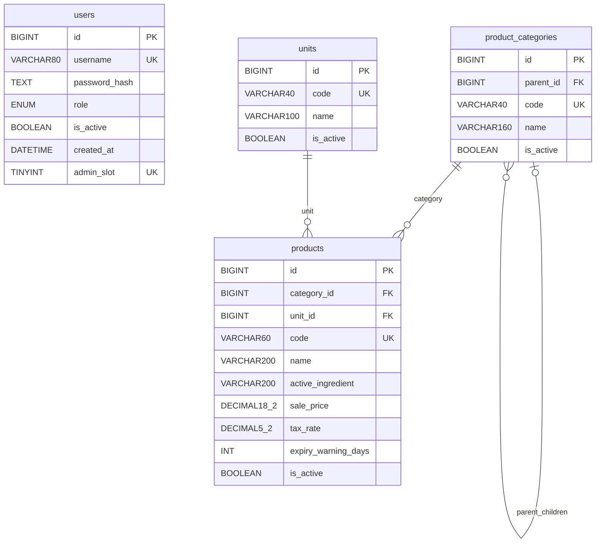

# ERD MySQL — thiết kế G2 theo module đã chọn

Ngày 17/10/2026. Thiết kế hiện hành theo G2_DECISIONS.md; chưa tạo database hoặc migration. Target MySQL 8.4/InnoDB/utf8mb4, database `mnm_vat_tu_nong_nghiep` độc lập.

users là bảng độc lập vì role enum cố định; không có quan hệ giả đến bảng catalog. Bốn bảng nghiệp vụ, ba FK. Migration ledger của Laravel là hạ tầng sau này, không tính là bảng nghiệp vụ. Session/cache dùng file riêng, queue null; chưa cần sessions/jobs/cache/password_reset_tokens/personal_access_tokens.

## Kiểu, nullability và mặc định

| Bảng | Cột và quy tắc |
|---|---|
| users | id BIGINT signed AUTO_INCREMENT PK; username VARCHAR(80) NOT NULL UNIQUE; password_hash TEXT NOT NULL; role ENUM('admin','user') NOT NULL DEFAULT 'user'; is_active BOOLEAN NOT NULL DEFAULT true; created_at DATETIME NOT NULL DEFAULT CURRENT_TIMESTAMP theo UTC; admin_slot TINYINT GENERATED ALWAYS AS (CASE WHEN role='admin' THEN 1 ELSE NULL END) STORED UNIQUE |
| product_categories | id BIGINT signed AUTO_INCREMENT PK; parent_id BIGINT signed NULL; code VARCHAR(40) NOT NULL UNIQUE; name VARCHAR(160) NOT NULL; is_active BOOLEAN NOT NULL DEFAULT true |
| units | id BIGINT signed AUTO_INCREMENT PK; code VARCHAR(40) NOT NULL UNIQUE; name VARCHAR(100) NOT NULL; is_active BOOLEAN NOT NULL DEFAULT true |
| products | id BIGINT signed AUTO_INCREMENT PK; category_id/unit_id BIGINT signed NOT NULL; code VARCHAR(60) NOT NULL UNIQUE; name VARCHAR(200) NOT NULL; active_ingredient VARCHAR(200) NULL; sale_price DECIMAL(18,2) NOT NULL DEFAULT 0; tax_rate DECIMAL(5,2) NULL; expiry_warning_days INT NULL; is_active BOOLEAN NOT NULL DEFAULT true |

Tất cả PK/FK có cùng signedness; API/form ID là chuỗi dương tối đa 9223372036854775807 theo DecimalId. Không `$table->id()` unsigned rồi ghép FK signed. Không tự thêm updated_at/deleted_at cho catalog.

## Ràng buộc và tương thích

- Self FK parent_id→product_categories.id; category_id→product_categories.id; unit_id→units.id. Mọi ON DELETE/UPDATE là RESTRICT. Index parent_id, category_id, unit_id; tìm theo tên/id giữ thứ tự ổn định.
- CHECK sale_price>=0; tax_rate NULL hoặc 0..100; expiry_warning_days NULL hoặc 0..3650; boolean bị giới hạn 0/1. DecimalLimit(16,2) nghĩa 16 chữ số nguyên + 2 lẻ, tương ứng DECIMAL(18,2), không DECIMAL(16,2). Không float cho tiền.
- Giữ cấm tự trỏ bằng BEFORE INSERT/UPDATE trigger: NEW.parent_id = NEW.id thì SIGNAL. Với insert ID tự sinh NEW.id=0 trước khi cấp, không cho form cung cấp PK; insert explicit ID nếu có phải bị trigger kiểm. Vòng nhiều cấp và active-parent cần service transaction khóa cây/duyệt ancestor như KLCN. Trigger self-reference không thay thế cycle validation.
- MySQL cấm CHECK tham chiếu cột AUTO_INCREMENT; vì thế không chép `CHECK(parent_id<>id)` nguyên từ PostgreSQL. Trigger và CHECK/race vẫn phải chạy thử MySQL ở G4. [MySQL CHECK](https://dev.mysql.com/doc/refman/8.4/en/create-table-check-constraints.html), [trigger](https://dev.mysql.com/doc/refman/8.4/en/trigger-syntax.html).
- admin_slot unique giữ tối đa một Admin từ singleton catalog admin G1; enum role thay assignments theo phạm vi quyền đã đơn giản hóa. Generated expression không tham chiếu PK auto_increment. [MySQL generated columns](https://dev.mysql.com/doc/refman/8.4/en/create-table-generated-columns.html).
- Default collation utf8mb4_0900_as_cs; cột code/username dùng utf8mb4_0900_bin để không gộp mã khác hoa/thường hoặc dấu. Tra cứu dùng LOWER/LIKE như nguồn trên code/name/active_ingredient; giữ wildcard %/_ của LIKE và kiểm Unicode/collation parity ở G4. Không tuyên bố mọi sort PostgreSQL/MySQL tương đương khi chưa có test.
- Create category: parent phải active nếu được chọn. Update category: nếu category kết quả active thì parent active; vẫn chống cycle cho mọi trạng thái. Product active hoặc thay category/unit thì đối tượng tham chiếu phải active. Category bị ngừng không tự cascade ngừng con.

## Eloquent dự kiến

ProductCategory belongsTo(parent)/hasMany(children)/hasMany(products); Unit hasMany(products); Product belongsTo(category)/belongsTo(unit). User giữ getAuthPasswordName=password_hash, xác thực username + is_active; bỏ Sanctum/token. Policy/middleware kiểm Admin/User ở server; role không mass-assign từ form nhân viên.

Đã kiểm cấu trúc ERD và đối chiếu trường/rule với SQL + CatalogWriteController G1. Mermaid là nguồn sơ đồ chưa render; MySQL DDL, trigger, migrations và runtime chưa chạy. Đây là đặc tả G2, không phải bằng chứng có database.
