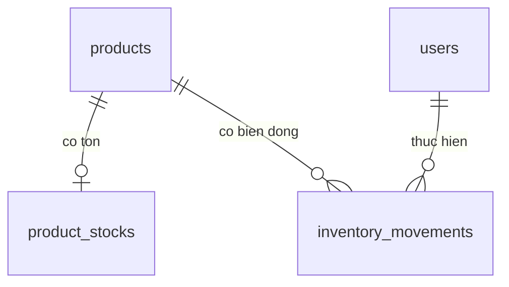

# Thiết kế Cụm 1

Nguồn: yêu cầu Cụm 1 ngày 21/10/2026, code hiện hành và MySQL test đọc lại. Framework, dependency và bốn migration cũ giữ nguyên; dùng quy ước khóa signed BIGINT của source hiện có.

| Bảng mới | Nội dung | Quan hệ/ràng buộc |
|---|---|---|
| `product_stocks` | id, product_id, quantity DECIMAL(15,3), updated_at | UNIQUE product_id; FK products RESTRICT; CHECK quantity >= 0 |
| `inventory_movements` | id, product_id, user_id, direction, quantity, quantity_before/after, note, idempotency_key, source_type/id, created_at | FK products/users RESTRICT; token UNIQUE; nguồn UNIQUE; 3 CHECK; 2 trigger chặn UPDATE/DELETE |

Hai bảng thêm 16 cột, 3 FK, 4 CHECK và 2 trigger. Schema test tổng cộng 6 bảng nghiệp vụ, 42 cột, 6 FK, 11 CHECK, 4 trigger; không tính bảng migrations. Schema nghiệp vụ hiện hữu vẫn 4 bảng nghiệp vụ.

`Product::stock()` và `inventoryMovements()`, `User::inventoryMovements()`, hai model mới có các quan hệ ngược tương ứng. Không thêm quantity vào products hoặc trường sửa tồn ở CRUD. Vật tư và người thao tác đã có lịch sử không được xóa làm mất nguồn; không đổi đơn vị tính của vật tư sau khi phát sinh kho. Các trường thông tin vật tư khác tiếp tục theo validation cũ. Lịch sử tham chiếu tên/mã hiện tại, chưa lưu bản chụp tên tại thời điểm giao dịch.

`InventoryService::move()` là điểm ghi kho chung. Trong transaction MySQL, service đọc lại Admin đang hoạt động với shared lock, khóa product bằng `lockForUpdate`, kiểm token, trạng thái vật tư, khóa/đọc tồn, kiểm số lượng rồi cập nhật tồn và thêm movement. Khóa product tồn tại ngay cả khi chưa có stock, nên hai lần nhập đầu không tạo hai stock. Thất bại ở bất kỳ bước nào rollback cả hai phần; transaction thử lại deadlock tối đa 3 lần.

DECIMAL được đọc/ghi dưới dạng chuỗi, tính toán bằng số nguyên đơn vị 1/1000 trên PHP64bit. Tối đa 999999999999.999; số âm, 0, quá 3 số lẻ, float, số mũ và giá trị vượt miền bị từ chối. Xuất vượt tồn bị từ chối. Thời gian lưu/hiển thị UTC và bộ lọc ngày cũng theo UTC.

Token UUID giữ trong biểu mẫu. Gửi lại phải khớp vật tư, chiều, số lượng chuẩn hóa, ghi chú, nguồn và người thực hiện; trả movement cũ, không ghi thêm. Token trùng với nội dung khác bị từ chối. UNIQUE bảo vệ cả hai request khác vật tư cùng tranh token; transaction thua rollback stock trước khi xử lý replay. Mỗi biểu mẫu mới nhận token mới.

Nguồn hiện tại `manual`, source_id NULL. Service dự phòng `sale`/`purchase` với source_id **định danh dòng chứng từ**, không dùng chung ID đầu phiếu cho nhiều vật tư. UNIQUE(source_type, source_id) chống cộng/trừ lại một dòng nguồn. HTTP thủ công không được truyền nguồn, actor, chiều hoặc số tồn trước/sau. Chưa có hóa đơn hay phiếu nhà cung cấp; khi triển khai sau phải gọi chung service trong transaction xác nhận chứng từ, khóa các vật tư theo thứ tự thống nhất và giữ token dòng. Không xây luồng cộng tồn thứ hai.

Quyền được kiểm bằng auth/active/admin middleware, FormRequest và service đọc lại actor. Lịch sử không có route sửa/xóa; model và trigger chặn sửa/xóa. Middleware chỉ báo chưa cài đặt nếu hai bảng thiếu, không chạy migration. Ràng buộc và trigger được kiểm trên MySQL thật, không dùng SQLite thay thế.

Test profile cần đồng thời APP_ENV=inventory-testing, MNM_INVENTORY_TEST=isolated-c1 và đúng tên database test cố định; guard chỉ chấp nhận hai account test đã provision, cùng host/datadir MySQL được kiểm. Cookie/session/cache/view tách riêng môi trường nghiệp vụ. TestCase từ chối chạy ngoài profile này.

Giới hạn: chưa migrate database nghiệp vụ, chưa triển khai kiểm kê/điều chỉnh ngược phiếu, lô/hạn dùng, nhiều kho hoặc chứng từ bán/nhập. Tồn là số tính từ các phiếu đã ghi; muốn đối chiếu hàng thực tế cần nghiệp vụ kiểm kê riêng. Migration có trigger cần phiên DDL đủ quyền trên MySQL bật binlog. Lần test này chỉ chuyển bốn câu CREATE TRIGGER đã giới hạn tên/bảng tới phiên quản trị hợp lệ trên đúng schema test; không cấp SUPER cho ứng dụng hoặc đổi cấu hình MySQL. Trước triển khai thật phải duyệt và kiểm kế hoạch DDL riêng.
