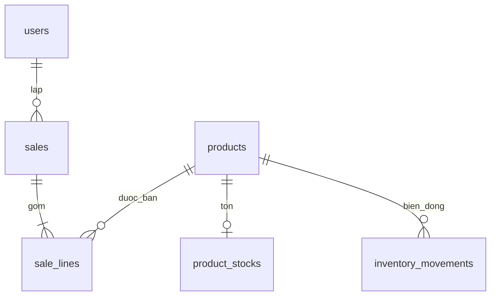

# Thiết kế C2

## Schema thực tế trên MySQL test

Migration `2026_10_21_000007_create_sales_tables.php` thêm sales/sale_lines: 20 cột mới, 3 FK RESTRICT, 5 CHECK, 5 trigger. Toàn schema test: 8 bảng nghiệp vụ/62 cột/9 FK/16 CHECK/9 trigger, cộng bảng migrations. ERD G6 giữ nguyên theo checkpoint lịch sử.

| Bảng | Dữ liệu chính | Quan hệ |
|---|---|---|
| sales | id/user_id signed BIGINT; client_key UUID unique binary; payload_hash; draft/confirmed; version; total DECIMAL(18,2); note; confirmed_at; timestamps | Thuộc User, có nhiều SaleLine |
| sale_lines | id/sale_id/product_id signed BIGINT; snapshot mã/tên/đơn vị; quantity DECIMAL(15,3); unit_price/line_total DECIMAL(18,2) | Thuộc Sale và Product; unique sale_id/product_id |
| inventory_movements đã có | source_type=sale; source_id là chuỗi sale_line.id; xuất kho; lượng trước/sau; user_id | Nguồn đa hình theo dòng, không có FK trực tiếp sale_line |

Eloquent: User.sales, Sale.user/lines, SaleLine.sale/product, Product.saleLines. Snapshot dòng giữ mã/tên/đơn vị/đơn giá tại lần lưu nháp cuối; phiếu đã xác nhận không lấy ngược giá hiện tại khi in.

## Transaction và thao tác lặp

Lưu nháp: kiểm active actor → khóa phiếu → owner/version → khóa products tăng dần → tính tiền → lưu header/dòng trong một transaction. Draft không giữ hoặc trừ tồn. client_key chống tạo trùng; payload chuẩn hóa, sắp theo product_id rồi băm. Cùng khóa/nội dung trả phiếu cũ, nội dung khác bị từ chối. Sửa draft yêu cầu version hiện hành.

Xác nhận: khóa actor/phiếu → owner/version → nếu đã confirmed trả kết quả cũ → khóa dòng/products theo product_id tăng dần → InventoryService.sell từng dòng → kiểm tổng → đổi trạng thái cuối cùng. Tất cả trong outer transaction; thiếu tồn/lỗi dòng sau rollback toàn bộ. Transaction retry tối đa3 khi gặp lỗi đồng thời phù hợp Laravel.

InventoryService.sell dùng lại record/stock/movement C1, yêu cầu transaction bao ngoài và phiếu draft của actor; không có endpoint gọi trực tiếp phương thức này. Nó lấy lại dòng từ DB, không tin product/quantity từ client. Unique source theo sale_line, không dùng sale_id chung cho cả phiếu. Không có luồng trừ kho thứ hai; kho tay vẫn chỉ Admin.

Model và trigger MySQL chặn sửa/xóa confirmed. Trigger dòng chặn thêm/sửa/xóa vào confirmed và đổi parent. CHECK kiểm trạng thái/thời điểm, tiền không âm, lượng dương và line_total = ROUND(quantity * unit_price,2). FK RESTRICT bảo vệ tham chiếu người lập/vật tư.

## Tiền và số lượng

Số lượng dùng milli-unit C1, tối đa3 số lẻ. Tiền dùng integer cent và DECIMAL(18,2), nhận chuỗi tối đa16 chữ số nguyên/2 số lẻ, không float. Đơn giá0 được chấp nhận phù hợp giá vật tư hiện hành.

Thành tiền = quantity × unit_price, làm tròn half-up đến0.01 VND từng dòng; tổng cộng các dòng đã làm tròn. Ví dụ0.005 ×1.00 =0.01; hai dòng như vậy tổng0.02. Tách phần nguyên/phần nghìn trước nhân, kiểm vượt DECIMAL(18,2) ở dòng và tổng. Test đối chiếu oracle MySQL DECIMAL ROUND. Không thêm dòng tính thuế/chiết khấu riêng từ field sản phẩm cũ.

## HTTP và giao diện

8 route C2 có web/auth/active/EnsureInventoryInstalled/EnsureSalesInstalled. Thiếu schema trả503, không tự migration. Controller giới hạn User theo owner và trả404 cho phiếu ngoài phạm vi. Service đọc lại role/active/owner; Admin đọc toàn bộ nhưng không sửa/xác nhận thay nhân viên. Request ghi có CSRF.

Blade dùng lại layout/Bootstrap và bảng cuộn ngang; gồm danh sách, form, dòng form, chi tiết, bảng dòng, in, thông báo thiếu schema. JS thêm/xóa tối đa50 dòng, ít nhất1; không tái dùng index sau xóa, kể cả old input có chỉ số thưa. Đơn giá truyền chuỗi; lưu nháp để tính tổng từ server.

Ngày giờ lưu/hiển thị/lọc UTC có nhãn. Hóa đơn là chứng từ nội bộ. CSS A4/window.print đã có; visual1366/768/320 và hộp thoại in **PENDING**, không suy kết quả browser từ Node DOM giả lập.
