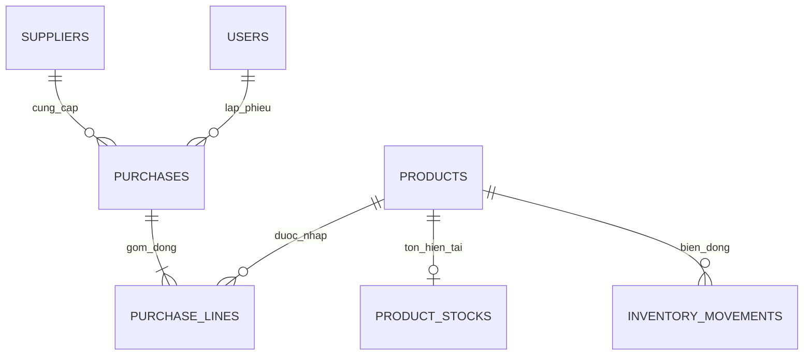

# Thiết kế C3 — Nhà cung cấp và phiếu nhập

## Phạm vi và quyền

Laravel monolith hiện hữu; Blade/Bootstrap offline; đúng2role. Admin CRUD nhà cung cấp và tạo/sửa/xác nhận phiếu nhập mình lập. User xem/tìm/lọc/phân trang nhà cung cấp và toàn bộ phiếu nhập; không ghi. Middleware auth/active/schema/admin chặn trước controller; service kiểm lại role/active/ownership từ database. Không thay quyền C1/C2.

## Schema test mới

| Bảng | Cột | Khóa và ràng buộc |
|---|---|---|
| suppliers | id,code,name,phone,email,address,is_active (7) | BIGINT signed;code unique;active boolean;code/name không rỗng |
| purchases | id,user_id,supplier_id,supplier_code,supplier_name,supplier_phone,supplier_address,client_key,payload_hash,status,version,total,note,confirmed_at,created_at,updated_at (16) | FK User/Supplier RESTRICT;UUIDclient_key unique/binary;status draft/confirmed;version>0;total>=0;state/time CHECK |
| purchase_lines | id,purchase_id,product_id,product_code,product_name,unit_name,quantity,unit_price,line_total (9) | FK Purchase/Product RESTRICT;unique purchase/product;quantity DECIMAL15,3>0;tiền DECIMAL18,2>=0;line_total=ROUND(qty×price,2) |

Migration000008 thêm32cột/4FK/7CHECK/5trigger. Toàn schema test11bảng nghiệp vụ/94cột/13FK/23CHECK/14trigger,8migration. Không sửa migration đã nghiệm thu; không migrate database nghiệp vụ.

Eloquent: Supplier.purchases,Purchase.supplier/user/lines,PurchaseLine.purchase/product,Product.purchaseLines,User.purchases. Movement lưu source_type=purchase/source_id=purchase_line.id; đây là tham chiếu nguồn đa hình của C1, không là FK vật lý xuyên nhiều bảng. Unique source_type/source_id và ledger readback kiểm mỗi dòng confirmed có đúng1movement; draft không có movement.

## Transaction, tính tiền và chống lặp

Draft: UUID client_key chuẩn hóa, quantity milli/price cent, sort product_id tăng dần, hash supplier_id/note/lines. Cùng key/cùng nội dung trả cùng phiếu; khác nội dung trả422. Update phải cùng owner/key/version và còn draft; version tăng sau sửa. Draft không giữ hoặc cộng tồn. Không nhận status,total,user_id từ người gửi.

Confirm: transaction toàn phiếu; active Admin shared lock → header FOR UPDATE → supplier FOR UPDATE → lines/product tăng dần → InventoryService.receive → cơ chế record C1 khóa stock/ghi movement → kiểm tổng → confirmed. Tối đa3lần retry deadlock. Một dòng lỗi, tổng sai, vật tư ngừng hoặc tràn tồn đều rollback cả header/stock/movement. Confirmed cùng version trả lại phiếu, không ghi lại; version cũ bị từ chối.

Mọi tiền dùng SaleMoney của C2 nguyên trạng (cent,half-up từng dòng,add kiểm trước cộng). Quantity dùng StockQuantity milli; chặn tồn vượt DECIMAL15,3. Không có float, công nợ/thuế/chiết khấu riêng. Giá nhập được nhập riêng, không lấy mặc định giá bán.

Nhà cung cấp/vật tư hoạt động được kiểm cả khi draft và confirm. Tên/mã/điện thoại/địa chỉ supplier và thông tin vật tư là snapshot khi lưu nháp; đổi tên đối tác sau đó không sửa lịch sử phiếu. Đơn vị tính đổi trước confirm cần lưu lại draft để cập nhật snapshot. Sau movement, quy tắc C1 giữ đơn vị tính. C3 không thêm cách sửa trực tiếp tồn hoặc luồng nhập song song.

Model và5trigger chặn UPDATE/DELETE header confirmed, INSERT/UPDATE/DELETE dòng confirmed, chuyển dòng sang header khác. FK RESTRICT không xóa nhà cung cấp có phiếu; có thể ngừng hoạt động. Không hỗ trợ xóa/hủy phiếu nhập đã xác nhận trong C3.

## Giao diện và giới hạn kiểm

Nhà cung cấp3view và phiếu nhập7view dùng layout/component hiện hữu. Form1–50dòng có thêm/bỏ dòng; chỉ số tăng từ max old input để tránh trùng key. Validation và tổng tiền ở server. Trang in dùng sales-print.css C2 và nút window.print; HTML đã kiểm, responsive1366/768/320 và print dialog/PDF chưa kiểm trực quan vì thiếu tool callable.
