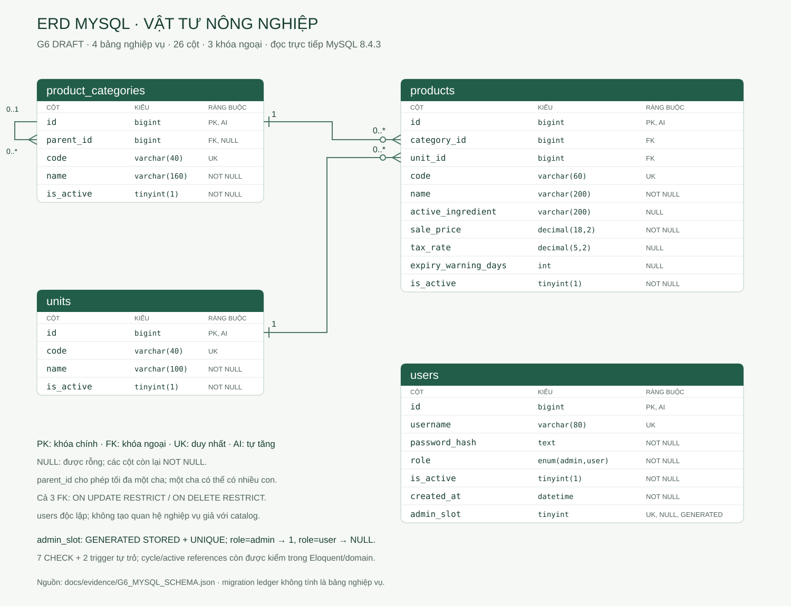

# ERD MySQL thực tế — G6 DRAFT

Nguồn mới: [G6_MYSQL_SCHEMA.json](../evidence/G6_MYSQL_SCHEMA.json), đọc SELECT information_schema trên đúng mnm_vat_tu_nong_nghiep/MySQL8.4.3; [readback](../evidence/G6_MYSQL_READBACK.json) kiểm trigger/grants. Không lấy schema PostgreSQL/MongoDB của KLCN. Bốn bảng nghiệp vụ có26cột, baFK và bảyCHECK; migrations là ledger hạ tầng, không tính vào bốn bảng. Không có bảng roles/orders/inventory/session/job trong phạm vi này.

## 1. Quan hệ và lực lượng

| Quan hệ | Lực lượng và nullability | Cập nhật/xóa |
|---|---|---|
| product_categories.parent_id → product_categories.id | Mỗi danh mục có0..1cha; một cha có0..ncon; parent_id nullable | RESTRICT/RESTRICT |
| products.category_id → product_categories.id | Một vật tư thuộc đúng1danh mục; danh mục có0..nvật tư; FK NOT NULL | RESTRICT/RESTRICT |
| products.unit_id → units.id | Một vật tư dùng đúng1đơn vị; đơn vị có0..nvật tư; FK NOT NULL | RESTRICT/RESTRICT |

users độc lập, không thêm FK giả tới vật tư. PK/FK BIGINT signed, ID ứng dụng dạng chuỗi dương ≤9223372036854775807; không đổi sang unsigned/UUID hoặc float. Catalog không tự thêm updated_at/deleted_at. Quan hệ Eloquent: ProductCategory parent/children/products, Unit products, Product category/unit.

## 2. Từ điển26cột từ metadata thực

PRI: primary key; UNI: unique; MUL: index không duy nhất (xem FK ở trên). Kiểu boolean lưu tinyint(1); CHECK giới hạn0/1. Cột EXTRA giữ thông tin auto_increment/generated/default thực tế.

| Bảng | Cột | Kiểu MySQL | Nullable | Key | Default | Extra |
|---|---|---|---|---|---|---|
| product_categories | id | `bigint` | NO | PRI | không khai báo | auto_increment |
| product_categories | parent_id | `bigint` | YES | MUL | NULL | — |
| product_categories | code | `varchar(40)` | NO | UNI | không khai báo | — |
| product_categories | name | `varchar(160)` | NO | — | không khai báo | — |
| product_categories | is_active | `tinyint(1)` | NO | — | 1 | — |
| products | id | `bigint` | NO | PRI | không khai báo | auto_increment |
| products | category_id | `bigint` | NO | MUL | không khai báo | — |
| products | unit_id | `bigint` | NO | MUL | không khai báo | — |
| products | code | `varchar(60)` | NO | UNI | không khai báo | — |
| products | name | `varchar(200)` | NO | — | không khai báo | — |
| products | active_ingredient | `varchar(200)` | YES | — | NULL | — |
| products | sale_price | `decimal(18,2)` | NO | — | 0.00 | — |
| products | tax_rate | `decimal(5,2)` | YES | — | NULL | — |
| products | expiry_warning_days | `int` | YES | — | NULL | — |
| products | is_active | `tinyint(1)` | NO | — | 1 | — |
| units | id | `bigint` | NO | PRI | không khai báo | auto_increment |
| units | code | `varchar(40)` | NO | UNI | không khai báo | — |
| units | name | `varchar(100)` | NO | — | không khai báo | — |
| units | is_active | `tinyint(1)` | NO | — | 1 | — |
| users | id | `bigint` | NO | PRI | không khai báo | auto_increment |
| users | username | `varchar(80)` | NO | UNI | không khai báo | — |
| users | password_hash | `text` | NO | — | không khai báo | — |
| users | role | `enum('admin','user')` | NO | — | user | — |
| users | is_active | `tinyint(1)` | NO | — | 1 | — |
| users | created_at | `datetime` | NO | — | CURRENT_TIMESTAMP | DEFAULT_GENERATED |
| users | admin_slot | `tinyint` | YES | UNI | NULL | STORED GENERATED |

admin_slot là STORED GENERATED theo CASE role=admin THEN1 ELSE NULL; UNIQUE chỉ bảo đảm tối đa một Admin, không bảo đảm luôn có một Admin active. Quy tắc không xóa/hạ quyền/ngừng Admin được ứng dụng bảo vệ và readback hiện xác nhận1Admin active. Bốn PK tự tăng; code và username dùng utf8mb4_0900_bin, tên dùng utf8mb4_0900_as_cs. Mặc định created_at theo CURRENT_TIMESTAMP/connection UTC, không tự đổi sang múi giờ hiển thị Việt Nam trong schema.

## 3. CHECK và trigger

| Bảng | Constraint | Mệnh đề đọc trực tiếp |
|---|---|---|
| product_categories | categories_active_check | `(`is_active` in (0,1))` |
| products | products_active_check | `(`is_active` in (0,1))` |
| products | products_expiry_check | `((`expiry_warning_days` is null) or (`expiry_warning_days` between 0 and 3650))` |
| products | products_price_check | `(`sale_price` >= 0)` |
| products | products_tax_check | `((`tax_rate` is null) or (`tax_rate` between 0 and 100))` |
| units | units_active_check | `(`is_active` in (0,1))` |
| users | users_active_check | `(`is_active` in (0,1))` |

Hai trigger categories_no_self_insert/categories_no_self_update chặn parent_id=id; định nghĩa khớp G4A theo readback. Vòng nhiều cấp và active references cần domain/model, không suy chỉ baFK đã ngăn mọi vòng. Không cascade xóa hoặc cascade trạng thái.

[Mermaid nguồn](diagrams/erd.mmd) mô tả cùng bốn bảng/26trường/baquan hệ; [SVG](diagrams/erd.svg) hiển thị từ metadata, gồm kiểu/nullable/key và chú giải. Thiết kế G2/ERD cũ giữ lịch sử; bản này phản ánh schema đã đọc trên runtime, không phải lệnh tạo database/migration mới.
