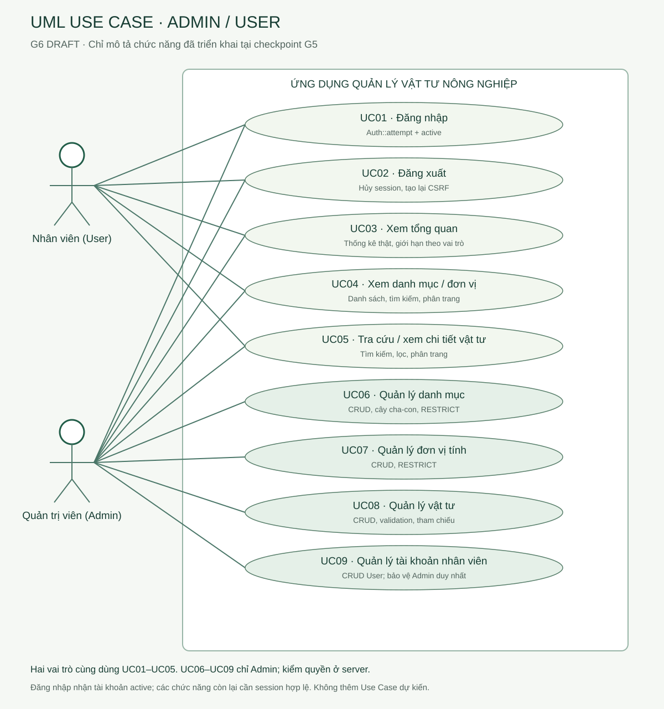

# UML Use Case và mô tả luồng — G6 DRAFT

Hai actor đúng role triển khai: User và Admin;9Use Case/14association. Không suy actor khách hàng/chủ chuỗi/quản lý chi nhánh từ KLCN. Đăng nhập xảy ra khi chưa có session; UC02–UC09 yêu cầu session và tài khoản active, UC06–UC09 thêm Admin. Admin dùng cả năm UC01–UC05, User không có quyền ghi.

| ID | Chức năng | Actor | Phạm vi đã có |
|---|---|---|---|
| UC01 | Đăng nhập | Admin/User | Auth::attempt + active |
| UC02 | Đăng xuất | Admin/User | Hủy session, tạo lại CSRF |
| UC03 | Xem tổng quan | Admin/User | Thống kê thật, giới hạn theo vai trò |
| UC04 | Xem danh mục / đơn vị | Admin/User | Danh sách, tìm kiếm, phân trang |
| UC05 | Tra cứu / xem chi tiết vật tư | Admin/User | Tìm kiếm, lọc, phân trang |
| UC06 | Quản lý danh mục | Admin | CRUD, cây cha-con, RESTRICT |
| UC07 | Quản lý đơn vị tính | Admin | CRUD, RESTRICT |
| UC08 | Quản lý vật tư | Admin | CRUD, validation, tham chiếu |
| UC09 | Quản lý tài khoản nhân viên | Admin | CRUD User; bảo vệ Admin duy nhất |

## Luồng tiêu biểu

**UC01 — Đăng nhập.** Actor mở login, nhập username/password; LoginRequest kiểm biểu mẫu, rate limiter chặn quá nhiều lần, Auth::attempt chỉ nhận is_active=true. Thành công regenerate session và về intended URL hoặc products. Thất bại báo tiếng Việt, không lộ password_hash; quá5lần sai trong cửa sổ60giây theo implementation trả429. Không có đăng ký công khai hoặc reset password.

**UC02 — Đăng xuất.** Actor gửi form POST có CSRF; hệ thống logout, invalidate session, regenerate token, chuyển về login (JSON204). Cookie cũ không dùng lại để truy cập route bảo vệ. Không dùng GET logout.

**UC03 — Tổng quan.** Actor mở dashboard; hệ thống đếm thật trên bốn bảng, đọc các vật tư/danh mục hiện hữu, không ghi dữ liệu. User không thấy count/link quản lý tài khoản. Đây là tổng quan catalog, không có doanh thu/tồn kho/đơn hàng.

**UC04/UC05 — Xem/tra cứu.** Actor mở danh sách, nhập từ khóa hoặc bộ lọc hợp lệ, hệ thống query Eloquent và phân trang ổn định; actor chuyển trang và xem chi tiết. Không có kết quả thì hiển thị empty state; ID/sốtrang/filter không hợp lệ trả lỗi theo contract. Xem danh mục và đơn vị gồm chi tiết; không nhầm khả năng xem với quyền tạo/sửa/xóa.

**UC06–UC08 — Quản lý catalog.** Admin mở form, nhập dữ liệu, submit POST hoặc PUT/PATCH với CSRF. FormRequest và domain kiểm dữ liệu/quan hệ/cây/decimal; hợp lệ lưu trong transaction và báo thành công. Sai giữ old-input/error. Xóa mở modal xác nhận; hủy không gửi DELETE. Đồng ý DELETE vẫn phải qua middleware/domain/FK RESTRICT; bản ghi có tham chiếu không bị xóa, không cascade. User gọi thẳng route ghi hoặc form Admin nhận403 trước render.

**UC09 — Tài khoản nhân viên.** Admin xem/thêm/sửa/xóa User hợp lệ; username unique, password confirmed tối thiểu10ký tự và tối đa72byte bcrypt, hash chỉ tạo trong server. Form không tạo Admin thứhai hoặc đổi role tùy ý. Chặn xóa/hạ quyền/ngừng Admin duy nhất. Khi user bị ngừng, active middleware chặn session cũ ở request sau.

Nguồn: [routes](../../routes/web.php), [SessionController](../../app/Http/Controllers/SessionController.php), [CatalogController](../../app/Http/Controllers/CatalogController.php), [UserController](../../app/Http/Controllers/UserController.php). [Mô hình JSON](diagrams/use-cases.json)/[PlantUML](diagrams/use-cases.puml)/SVG cùng tập ID/actor/association; không gắn include/extend khi luồng hiện hữu không cần. CRUD gộp thành Use Case quản lý; các thao tác C/R/U/D được mô tả trong luồng, không tạo nghiệp vụ chưa có.
